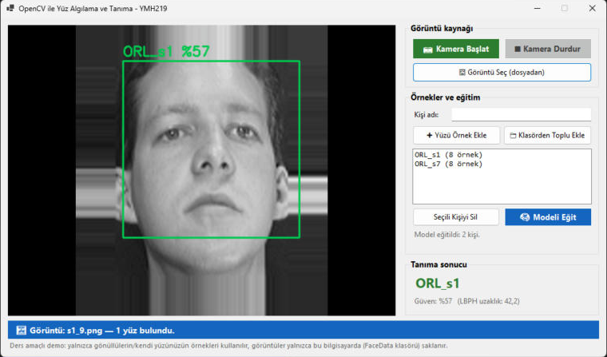
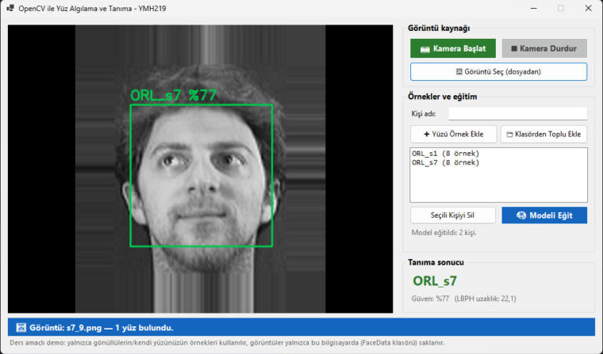
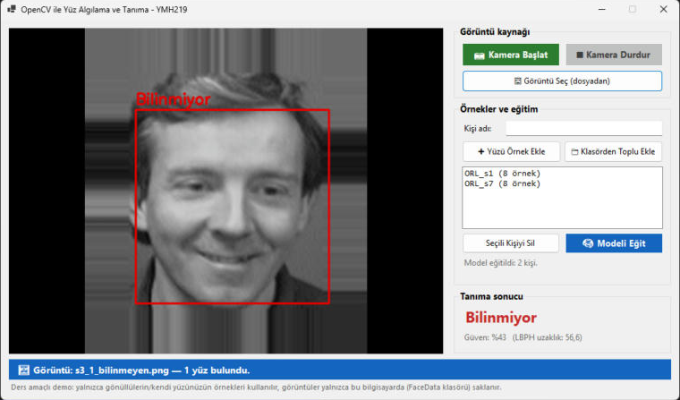
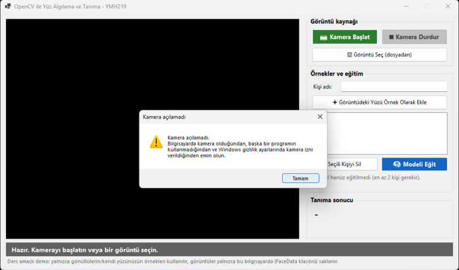

# OpenCV ile Yüz Algılama ve Tanıma — YMH219

OpenCvSharp (OpenCV'nin C# sarmalayıcısı) kullanan bir Windows Forms uygulaması. Kameradan veya seçilen bir resimden görüntü alır, **yüzleri dikdörtgenle işaretler** ve küçük bir yerel örnek kümesiyle eğitilen **LBPH** modeliyle yüzün kime ait olduğunu tahmin eder. Tahmin edilen etiket ve güven değeri ekranda gösterilir; modelin tanımadığı yüzler "Bilinmiyor" olarak işaretlenir.

Bu proje **Nesne Tabanlı Programlama (YMH 219)** dersi ek uygulama ödevi kapsamında hazırlanmıştır.

**Öğrenci:** Yusuf Aslan — **Numara:** 250541068

## Ekran Görüntüleri

| 1. kişi tanındı | 2. kişi tanındı |
|---|---|
|  |  |

| Eğitimde olmayan kişi → "Bilinmiyor" | Kamera bulunamadığında hata mesajı |
|---|---|
|  |  |

Test görüntüleri modelin eğitiminde **kullanılmamış** fotoğraflardır (her kişinin 9. fotoğrafı ve hiç eğitilmemiş üçüncü bir kişi).

## Kullanılan Teknolojiler / NuGet Paketleri

| Paket | Kullanım amacı |
|---|---|
| [OpenCvSharp4](https://www.nuget.org/packages/OpenCvSharp4) | OpenCV'nin C# arayüzü: görüntü işleme, `CascadeClassifier`, `LBPHFaceRecognizer` |
| [OpenCvSharp4.runtime.win](https://www.nuget.org/packages/OpenCvSharp4.runtime.win) | OpenCV'nin Windows yerel kütüphaneleri (yüz modülü dahil) |
| [OpenCvSharp4.Extensions](https://www.nuget.org/packages/OpenCvSharp4.Extensions) | `Mat` → `Bitmap` dönüşümü (PictureBox'ta göstermek için) |

- C# / .NET 10 (`net10.0-windows`, x64), Windows Forms
- Yüz algılama: OpenCV'nin hazır **Haar Cascade** modeli (`Data/haarcascade_frontalface_default.xml`, Intel lisansı dosyanın içinde)
- Yüz tanıma: **LBPH** (Local Binary Patterns Histograms)

## Kurulum ve Çalıştırma

1. Depoyu indirin:
   ```bash
   git clone https://github.com/JuseufLeo/YMH219-FaceRecognition.git
   ```
2. `YMH219-FaceRecognition.slnx` dosyasını **Visual Studio 2026** ile açın; NuGet paketleri ilk derlemede otomatik indirilir.
3. Yeşil **▶ FaceRecognition** düğmesine basın (veya `F5`).

## Kullanım

1. **Görüntü kaynağı:** **📷 Kamera Başlat** ile canlı görüntü alın ya da **🖼 Görüntü Seç** ile bir resim açın. Bulunan her yüz dikdörtgenle işaretlenir (aynı karede birden fazla yüz desteklenir).
2. **Örnek ekleme:**
   - **Tek tek:** "Kişi adı" kutusuna etiketi yazıp **➕ Yüzü Örnek Ekle**'ye basın; görüntüdeki en büyük yüz o kişiye örnek olarak kaydedilir.
   - **Toplu:** **📁 Klasörden Toplu Ekle** ile, her alt klasörü bir kişi olan bir klasör seçin (ör. `Ornekler/Ali/*.jpg`, `Ornekler/Ayse/*.jpg`).
3. **🧠 Modeli Eğit**'e basın (en az 2 kişi gerekir).
4. Yeni bir resim seçin veya kameraya bakın: tahmin edilen kişi, güven yüzdesi ve LBPH uzaklık değeri "Tanıma sonucu" bölümünde, etiket de yüzün üstünde görünür.

Örnekler `FaceData/<kişi adı>/` klasörüne 200×200 gri PNG olarak kaydedilir. Bu klasör **.gitignore** ile GitHub'a yüklenmez.

## Kullanılan Örnek Veri

Kişisel gizliliği korumak için tanıma gösteriminde, yüz tanıma araştırmaları için gönüllülerden çekilmiş **The ORL Database of Faces** (AT&T Laboratories Cambridge / Olivetti Research Laboratory, 1992–1994) veri setinden 2 kişi (her biri 8 eğitim + 1 test fotoğrafı) ve test için 1 bilinmeyen kişi kullanılmıştır. Algılamanın çalışması için görüntüler 3 kat büyütülüp kenar eklenmiştir. Örnek fotoğraflar depoda yer almaz; yalnızca ekran görüntülerinde görünür.

> F. Samaria and A. Harter, "Parameterisation of a stochastic model for human face identification", 2nd IEEE Workshop on Applications of Computer Vision, 1994. — [Veri seti sayfası](https://www.cl.cam.ac.uk/research/dtg/attarchive/facedatabase.html)

## Hata Yönetimi

- Kamera yoksa / açılamıyorsa: açıklayıcı mesaj, uygulama çalışmaya devam eder
- Kamera kullanım sırasında koparsa: uyarı verilir
- Haar Cascade model dosyası bulunamazsa: başlangıçta hata mesajı, algılama devre dışı kalır
- Seçilen dosya resim değilse, görüntüde yüz yoksa, etiket boşsa veya eğitim için yeterli kişi yoksa: kullanıcıya bilgi verilir

## Proje Yapısı (Sınıflar)

| Dosya | Görevi |
|---|---|
| `CameraService.cs` | `VideoCapture` ile kameradan arka planda kare okur, kareleri olayla bildirir |
| `FaceDetector.cs` | Haar Cascade ile yüzleri bulur; yüzü tanıma için 200×200 gri hâle getirir |
| `FaceDataset.cs` | Yerel yüz örneklerini klasörlerde saklar, eğitim için yükler |
| `FaceRecognizerService.cs` | LBPH modelini eğitir, tahmin yapar, eşik değerine göre "Bilinmiyor" kararı verir |
| `MainForm.cs` | Arayüz: görüntü gösterme, işaretleme, örnek ekleme, eğitim, sonuç ve durum bilgisi |

## Kapsam ve Güvenlik Sınırı

Bu çalışma yalnızca ders kapsamında, yerel ve gönüllü örneklerle yapılmıştır. Görüntüler sadece bu bilgisayarda işlenir ve saklanır; ağ üzerinden hiçbir yere gönderilmez. Kamuya açık alanlarda izinsiz kimlik tespiti veya gizli görüntü toplama amacıyla kullanılmamalıdır.

## Bilinen Sınırlamalar / Geliştirme Notları

- LBPH küçük veri setleri için uygun, basit bir yöntemdir; ışık, açı ve gözlük gibi değişikliklerde hata yapabilir. "Bilinmiyor" eşiği (`UnknownThreshold = 50`) örnek veriye göre ayarlanmıştır.
- Güven yüzdesi, LBPH uzaklık değerinden basitçe hesaplanmış yaklaşık bir değerdir (`100 − uzaklık`).
- OpenCV'nin yazı fonksiyonu Türkçe karakterleri desteklemediği için yüz üstündeki etiketlerde Türkçe karakter kullanılmaması önerilir.
- Eğitilen model kaydedilmez; uygulama her açıldığında **Modeli Eğit**'e yeniden basılmalıdır (örnekler kalıcıdır).
